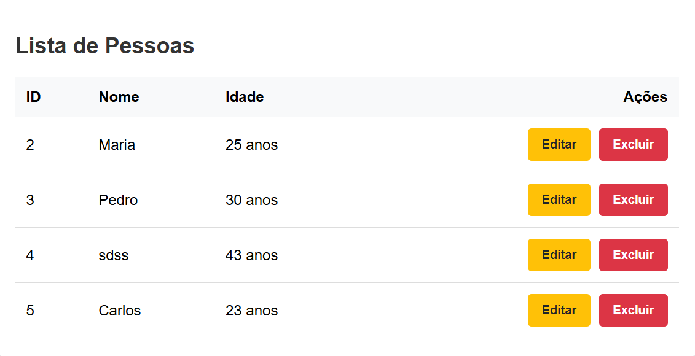

# Sistema de Gestão de Pessoas

<p align="center">
  <strong>Atividade 08 — Consumindo o Back-End no Front-End — CRUD Completo</strong>
</p>

<p align="center">
  
  
  
  
  
  
</p>

<p align="center">
  
  
  
</p>

---

## Sobre o projeto

O **Sistema de Gestão de Pessoas** é uma aplicação web desenvolvida para a **Atividade 08 — Consumindo o Back-End no Front-End — CRUD Completo**, da disciplina de **Programação Back-End**.

O projeto demonstra a integração entre um **Front-End desenvolvido com HTML5, CSS3 e JavaScript** e um **Back-End desenvolvido com Node.js e Express.js**, utilizando **MySQL/MariaDB** como banco de dados.

A aplicação permite realizar o gerenciamento de pessoas por meio de operações **CRUD**:

- **Create** — cadastro de pessoas;
- **Read** — consulta de pessoas;
- **Update** — atualização de dados;
- **Delete** — exclusão de registros.

A comunicação entre o Front-End e o Back-End é realizada por meio da **Fetch API**, utilizando requisições HTTP assíncronas.

---

## Objetivo

O principal objetivo do projeto é demonstrar, na prática, como uma aplicação Front-End pode consumir uma **API RESTful** e realizar operações sobre dados armazenados em um banco de dados.

Durante o desenvolvimento são utilizados conceitos como:

- Requisições HTTP;
- API REST;
- Fetch API;
- `async/await`;
- `try/catch`;
- Manipulação do DOM;
- Eventos JavaScript;
- Operações CRUD;
- Integração com banco de dados;
- Desenvolvimento de servidor com Express.js.

---

## Tecnologias utilizadas

### Front-End

| Tecnologia | Utilização |
|---|---|
| **HTML5** | Estrutura da interface |
| **CSS3** | Estilização da aplicação |
| **JavaScript ES6+** | Lógica e interação da aplicação |
| **Fetch API** | Comunicação com a API REST |

### Back-End

| Tecnologia | Utilização |
|---|---|
| **Node.js** | Ambiente de execução |
| **Express.js** | Criação do servidor e API |
| **CORS** | Controle de requisições entre origens |
| **dotenv** | Gerenciamento de variáveis de ambiente |

### Banco de dados

| Tecnologia | Utilização |
|---|---|
| **MySQL / MariaDB** | Persistência dos dados |
| **mysql2** | Comunicação entre Node.js e banco de dados |

---

## Estrutura do projeto

```text
meu-projeto/
│
├── .env
├── db.js
├── index.js
├── package.json
│
└── public/
    ├── index.html
    ├── style.css
    └── script.js
```

### Principais arquivos

- **`index.html`** — estrutura da interface da aplicação.
- **`style.css`** — estilos e apresentação visual.
- **`script.js`** — lógica do Front-End e consumo da API.
- **`index.js`** — servidor Express e endpoints da API.
- **`db.js`** — configuração da conexão com o banco de dados.
- **`.env`** — configurações e credenciais utilizadas pela aplicação.
- **`package.json`** — dependências e configurações do projeto.

---

## Como executar o projeto

### Pré-requisitos

Antes de executar a aplicação, é necessário possuir:

- [Node.js](https://nodejs.org/)
- MySQL ou MariaDB
- npm

Verifique se o Node.js está instalado:

```bash
node --version
```

E o npm:

```bash
npm --version
```

### 1. Clonar o repositório

```bash
git clone <URL_DO_REPOSITORIO>
```

Acesse a pasta do projeto:

```bash
cd <PASTA_DO_PROJETO>
```

### 2. Instalar as dependências

```bash
npm install
```

### 3. Configurar o banco de dados

Crie o banco de dados no MySQL/MariaDB conforme a estrutura utilizada pela aplicação.

Exemplo:

```sql
CREATE DATABASE sistema_gestao_pessoas;
```

Configure as informações necessárias no arquivo `.env`.

```env
DB_HOST=localhost
DB_USER=root
DB_PASSWORD=sua_senha
DB_NAME=sistema_gestao_pessoas
DB_PORT=3306
```

> **Importante:** não versione o arquivo `.env`, pois ele pode conter credenciais e informações sensíveis. Utilize um `.env.example` para documentar as variáveis necessárias.

### 4. Executar o servidor

```bash
node index.js
```

Após o servidor ser iniciado, acesse a aplicação pelo endereço configurado no projeto.

Exemplo:

```text
http://localhost:3000
```

---

## Comunicação entre Front-End e Back-End

A comunicação entre as duas partes da aplicação ocorre por meio de **requisições HTTP realizadas utilizando a Fetch API**.

O fluxo funciona da seguinte maneira:

```text
┌───────────────┐
│    Usuário    │
└───────┬───────┘
        │
        │ Interação
        ▼
┌───────────────┐
│   Front-End   │
│ HTML/CSS/JS   │
└───────┬───────┘
        │
        │ Fetch API
        │ HTTP
        ▼
┌───────────────┐
│   Express.js  │
│   API REST    │
└───────┬───────┘
        │
        │ mysql2
        ▼
┌───────────────┐
│ MySQL/MariaDB │
└───────┬───────┘
        │
        │ Resultado
        ▼
┌───────────────┐
│   Express.js  │
└───────┬───────┘
        │
        │ JSON / HTTP
        ▼
┌───────────────┐
│   Front-End   │
│  Atualiza DOM │
└───────────────┘
```

### Métodos HTTP utilizados

| Método | Operação | Função |
|---|---|---|
| `GET` | Read | Consultar registros |
| `POST` | Create | Criar novos registros |
| `PUT` | Update | Atualizar registros |
| `DELETE` | Delete | Excluir registros |

---

## CRUD

### Create

Permite cadastrar uma nova pessoa através do formulário.

```text
Formulário
    ↓
POST
    ↓
API
    ↓
Banco de dados
```

### Read

Permite consultar e exibir os registros existentes.

```text
Front-End
    ↓
GET
    ↓
API
    ↓
Banco de dados
    ↓
JSON
    ↓
Interface
```

### Update

Permite alterar os dados de uma pessoa já cadastrada.

```text
Formulário
    ↓
PUT
    ↓
API
    ↓
Banco de dados
```

### Delete

Permite remover um registro.

```text
Ação do usuário
    ↓
DELETE
    ↓
API
    ↓
Banco de dados
```

---

## Capturas de tela

### Formulário

<p align="center">
  
</p>

### Cadastro funcionando

<p align="center">
  
</p>

> Adicione as capturas de tela nos caminhos indicados acima antes de publicar o README.

---

## Funcionalidades

- [x] Cadastro de pessoas
- [x] Consulta de pessoas
- [x] Atualização de pessoas
- [x] Exclusão de pessoas
- [x] Consumo de API REST
- [x] Comunicação assíncrona com Fetch API
- [x] Manipulação do DOM
- [x] Tratamento de erros
- [x] Integração com MySQL/MariaDB

---

## Informações acadêmicas

| Informação | Dados |
|---|---|
| **Aluno** | Arthur Tardin |
| **Professor** | [Vitor Lima Santana](https://github.com/VitorLimaSantana) |
| **Disciplina** | Programação Back-End |
| **Atividade** | 08 |
| **Tema** | Consumindo o Back-End no Front-End — CRUD Completo |

---

## Status

**Concluído — Atividade Acadêmica**

Projeto desenvolvido para demonstrar a integração entre **Front-End, Back-End e banco de dados**, com implementação de um CRUD completo utilizando uma API RESTful.

---

<p align="center">
  Desenvolvido por <strong>Arthur Tardin</strong>
</p>